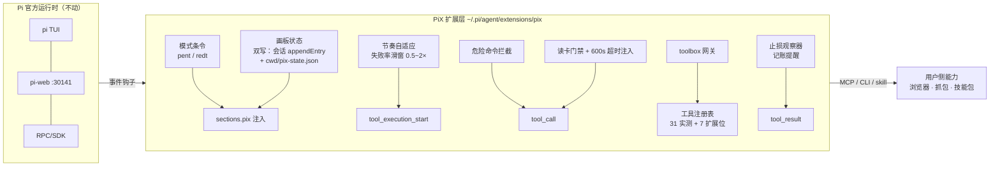
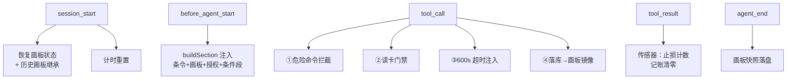

<div align="center">

# 🛡️ PiX — 假设驱动、自带渗透工具箱的 Pi Agent 发行版

**把渗透工程师的推理方式固化成系统机制：假设驱动 · 失败反刍 · 能力位置变换，再配一个按需发现的本地工具箱。**

基于 [@earendil-works/pi-coding-agent](https://www.npmjs.com/package/@earendil-works/pi-coding-agent) 扩展机制二次开发 · 不改上游一行代码 · 一切皆插件

      

</div>

---

## ✨ 特性一览

- 🧠 **机制化渗透纪律**：事实画板、失败强制回读、元认知反思、节奏自适应——不是提示词恳求，是事件钩子硬机制
- 🧰 **自带工具箱**：31 个实测渗透工具 + 7 张扩展位卡，`toolbox` 网关按需发现（list / howto / search）
- 🛡️ **双重护栏**：读卡门禁（未读卡禁调工具）+ 本机危险命令拦截 + 600s 超时注入
- 📊 **画板知识继承**：状态跨会话持久化，下次开工自动继承上次画板（不重复侦察）
- 🧾 **事实底表导出**：`/facts` 或 `/facts json` 一键导出不可篡改的 Ground Truth 纯事实底表（支持机器高保真 JSON 与表格化 Markdown），解耦排版，可无缝灌入任意自定义报告模板
- 🔬 **客观传感器**：多维阻断模式识别（WAF/限流/人机/域认证），连续拦截自动触发止损并反向推荐实战 SOP

---

## 📦 获取方式（重要，先看这里）

| 方式 | 内容 | 能否直接使用 |
|---|---|---|
| **A. 完整目录分发（推荐）** | 整个 PiX 目录，**含 `tools/`（约 2GB）**：31 个实测工具 + 全量字典树 + nuclei-templates 已内置 | ✅ 满足前置环境后**开箱即用** |
| **B. git clone（代码版）** | 仅代码（35 个文件），**不含 `tools/` 工具面** | ⚠️ 扩展可加载，但工具卡全部显示"不可用"——需自行放置 `tools/` 或设 `PIX_TOOLS_ROOT` 指向工具根 |

> **结论**：**直接用方式 A**（完整目录）。若走 git clone，工具面需另行获取——PiX 不提供在线工具下载脚本（工具内置化设计）。

---

## 🧰 前置要求（Windows）

| 环境 | 用途 | 安装命令 |
|---|---|---|
| **Node.js ≥ 22** | pi / pi-web 运行时 | `winget install OpenJS.NodeJS.LTS` |
| **Python 3.10+** | python 系工具（OneForAll/sqlmap 等）+ pi-web 补丁脚本 | `winget install Python.Python.3.10` |
| **Git** | 拉取/更新仓库 | `winget install Git.Git` |
| **Npcap** | nmap / masscan 抓包驱动 | [npcap.com 官网下载](https://npcap.com/#download)（勾选 WinPcap 兼容模式） |

> Linux/macOS：工具卡路径为 Windows 口径，需自行改 `extension/toolbox-data.ts` 注册表路径。

---

## 🚀 启动与关闭（成熟智能体专属控制台）

为提供工业级易用性，项目根目录预置了完整的管理启动与关闭脚本：

| 启动器脚本 | 核心作用 | 使用说明 |
|---|---|---|
| **`启动器.cmd`** (或 `launcher.cmd`) | **全功能交互式控制台** | 双击打开交互菜单，实时显示服务运行状态（端口 30141 占用与 PID），支持 [1] 启动 Web [2] 终端模式 [3] 状态巡检 [4] 停止关闭 [5] 武器自检 |
| **`pix-web.cmd`** | **一键极速启动 Web** | 双击直接同步扩展、启动 pi-web 并自动在浏览器打开 `http://127.0.0.1:30141`；控制台窗口明确提供关闭方式提示 |
| **`pix-stop.cmd`** | **一键彻底关闭与清理** | 双击即可一键安全终止所有后台监听进程与守护程序，**强制释放端口 30141**，杜绝孤儿进程残留 |
| **`pix.cmd`** | **终端交互直接对话** | 双击进入控制台全屏/终端直接对话模式 (pi CLI) |

### 快速启动与关闭姿势：

1. **方式 1：双击 `启动器.cmd`（推荐）**
   - 查看当前服务是否处于运行状态；
   - 输入 `1` 回车启动 Web 工作台并自动打开浏览器；
   - 需要关闭时，在菜单中输入 `4` 即可一键安全关闭所有服务。
2. **方式 2：双击 `pix-web.cmd` 启动，双击 `pix-stop.cmd` 关闭**
   - 随时双击 `pix-web.cmd` 开工；
   - 测试结束或需要释放端口时，随时双击 `pix-stop.cmd` 彻底收工。

## 🔑 配置模型（必须）

pi 默认无可用模型，首次使用需在 **pi-web 设置 → 模型** 或 `~/.pi/agent/models.json` 配置：

```json
{
  "providers": {
    "my-provider": {
      "baseUrl": "https://你的模型网关/v1",
      "models": [{ "id": "你的模型", "name": "你的模型", "supportsDeveloperRole": false }]
    }
  }
}
```

- OpenAI 兼容端点均可（`openai-completions` 协议）；`supportsDeveloperRole: false` 解决 `developer is not one of [...]` 报错
- 配好后在会话里选该模型即可

## 🌐 可选：外部能力接入

- **浏览器控制**：自配 `chrome-devtools-mcp`（`npx chrome-devtools-mcp@latest`）
- **抓包/重放**：自配 Burp Suite MCP bridge
- **技能包**：PiX 自带兜底作战技能（`pix-workflow`）；如需完整渗透/红队技能包，把技能目录加入 pi 技能路径即可，PiX 条令第 0 条自动让位

---

## 🏗️ 架构



### 运行时工作流



---

## ⚙️ 两模式

| | `/mode pent`（默认） | `/mode redt` |
|---|---|---|
| 定位 | SRC / 授权渗透 | 红队演练 |
| 授权事实源 | `/auth` 登记范围 | `/task` 任务书 |
| 节奏基准 | 2s（自适应 1~4s） | 1s（自适应 0.5~2s） |
| 核心条款 | 拖库口径（最小样本）· RCE 无害回显 · 禁 nuclei 全扫 | 任务书围栏 · 数据不出域 · 武器化按技能包 |

## 🧠 核心机制

1. **三段状态机 → 画板**：`[C]能力 / [F]失败 / [H]假设 / [N]发现`，`leads_to` 边即攻击链
2. **失败强制回读**：同方向失败 ≥6 次 → 自动注入回读指令（沿 `similar_to/substitutes` 边找可迁移能力）
3. **元认知反思**：失败率 ≥60% → 注入反思段（两模式差异化）
4. **节奏自适应**：`clamp(1+(失败率-0.5)×2, 0.5, 2)`——连败加倍克制、连胜自动提速
5. **本机危险命令分级拦截**：删盘/关机/格盘类——有 UI 弹确认，无 UI 直接拦截
6. **画板跨会话继承**：`cwd/pix-state.json` 原子双写，新会话注入【历史画板】摘要防重复侦察

## 🧰 工具箱

工具面不占 system prompt——单个 `toolbox` 工具按需发现：

```
toolbox({action:"list"})                        # 分类分组全量（含可用性探测）
toolbox({action:"search", task:"目录爆破"})      # 任务关键词 → top3 候选
toolbox({action:"howto", tool:"sqlmap"})        # 完整工具卡：唯一姿势/硬约束/参数/陷阱
```

**内置注册表 = 38 款纯 CLI 实战武器**（全部实测可用，随包 tools/ 分发，AI 原生无头可调）：

| 分类 | 核心武器 (38 款) |
|---|---|
| 信息收集 (14) | subfinder / OneForAll / crt.sh / httpx / EHole / nmap / masscan / dirsearch / ffuf / URLFinder / LinkFinder / katana / waybackurls / **rotor-goddess (转子女神-rg_cli)** |
| 漏洞利用 (4) | sqlmap / nuclei(+templates) / jwt_tool / JWTCrack |
| 内网横向与域攻坚 (13) | **fscan** / **netexec (nxc)** / **impacket** / **certipy (ADCS域提权)** / **bloodhound (域拓扑采集)** / **pypykatz (内存密码抓取)** / **ligolo-ng (极速TUN穿透)** / chisel / frp / proxychains / nc / winpeas / linpeas |
| 逆向与攻坚 (7) | capa / radare2 / yara-x / strings-bin / kubectl-ro |

**模式与调用**：武器全部适配 AI 直接 CLI 执行；`/toolbox export` 可导出全量工具卡手册（单文件 MD）。

## 📖 命令与工具参考

| 命令 | 用途 |
|---|---|
| `/mode pent \| redt` · `/mode adaptive on\|off` | 切换模式 / 节奏自适应开关 |
| `/auth <目标...> --source <来源>` | 登记授权范围（注入围栏） |
| `/task <任务书.md>` | 登记红队任务书 |
| `/pix` · `/pix export` | 状态总览 / 画板双 Mermaid 落盘 |
| `/facts` · `/facts json` | 导出不可篡改的 Ground Truth 纯事实底表（Markdown / 机器高保真 JSON，含资产、跳板、凭据、台账、漏洞原始请求包） |
| `/toolbox export` | 全量工具卡手册导出 |

| 工具 | 用途 |
|---|---|
| `record_host` | 登记内网主机资产（IP、系统、所属域、DC、PWNED控制状态、开放端口），智能增量合并服务 |
| `record_pivot` | 登记内网跳板与隧道（Socks5/FRP/SSH/TUN），建立内网网段透明路由映射 |
| `record_cred` | 登记已收割凭据（明文/NTLM/Kerberos/SSH），管理权限等级与已打通的内网主机 |
| `record_endpoint` | 登记 Web/API 接口资产台账（URL、方法、参数、来源），建立 100% 闭环测试追踪 |
| `update_endpoint` | 流转接口状态机（probing 探针 -> bypassing 绕过 -> confirmed 坐实 / rejected 排除） |
| `consult_tactics` | 即时动态检索内网横向、AD 域攻坚、隧道穿透与攻击面测绘顶级战术 SOP |
| `pivot_exec` | 目标处于内网时自动生成并注入原生代理参数或 proxychains 代理链路由命令 |
| `record_fact` / `record_capability` / `record_failure` | 画板记节点 + 连边 / 能力 / 失败计数（≥6 触发回读） |
| `update_node` | 节点状态流转（confirmed 联动节奏窗口与事实图谱坐实） |
| `get_state` / `get_task` | 读 4D 超图全量状态 / 任务书全文 |
| `export_map` | Mermaid 关系图（会话内返回） |
| `export_facts` | 一键导出客观事实底表（JSON / Markdown 双模态） |
| `toolbox` | 工具注册表网关（list / howto / search） |

## 🧪 验收

离线验收（真实 pi RPC + stub 模型回放，不打目标）：

```bash
cd acceptance && npm install && node run-acceptance.mjs
# 或一键（检查→部署→验收）
node scripts/ci-acceptance.mjs
```

31 项断言：模式注入（pent/redt/授权/任务书）、失败 6 次回读、元认知反思、节奏墙钟实测（连败 2s/连胜 0.5s/基准 2s）、护栏拦截、读卡门禁拦/放、会话重载读回、toolbox 三入口、update_node 联动、画板/报告落盘、历史画板继承。全程绿色即通过。

## 🔧 故障排查

| 症状 | 处置 |
|---|---|
| 启动无「PiX 已加载」通知 | `node scripts/install.mjs --status` 查文件一致性 |
| 工具卡显示「不可用」 | howto 里的 reason 给出原因；工具根可用 `PIX_TOOLS_ROOT` 覆盖 |
| 模型报 `developer is not one of [...]` | models.json 对应模型加 `"compat": {"supportsDeveloperRole": false}` |
| pi-web 推理菜单档位混乱 | 重跑 `node scripts/install.mjs --restart-piweb` |
| 验收某步 FAIL | 看输出 evidence；先确认扩展最新（install.mjs --status） |

---

## ⚖️ 合规声明

PiX 仅面向**已授权的安全测试**（自建靶场、书面授权 SRC、红队任务书范围）。pent 模式内置授权首条红线；redt 模式以任务书围栏。禁止用于未授权测试、DoS、数据牟利。使用者自行承担合规责任。

---

<div align="center">

**MIT License · 机制设计源自实战渗透方法论 · 工具与技能一切皆插件**

</div>
