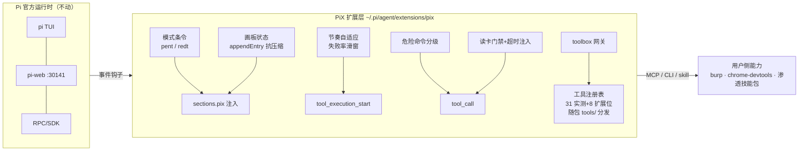

<div align="center">

# PiX

**假设驱动、自带渗透工具箱的 Pi Agent 发行版**

基于 [@earendil-works/pi-coding-agent](https://github.com/earendil-works/pi) 扩展机制二次开发 · 不改上游一行代码 · 一切皆插件

   

</div>

PiX 把渗透工程师的推理方式固化成系统机制：**假设驱动、失败反刍、能力位置变换**，再配一个按需发现的本地工具箱。它不是扫描器——nuclei/sqlmap 只是它的手；"怎么想"（事实画板、失败回读、节奏自适应、模式条令）才是它的芯。

在 [pi TUI](https://www.npmjs.com/package/@earendil-works/pi-coding-agent) 或 [pi-web](https://www.npmjs.com/package/@agegr/pi-web) 里以普通会话方式作业：登记授权 → 侦察 → 假设-实验-记录循环 → 导出画板与报告。

---

## 目录

- [快速开始](#快速开始)
- [架构](#架构)
- [两模式](#两模式)
- [核心机制](#核心机制)
- [工具箱](#工具箱)
- [命令与工具参考](#命令与工具参考)
- [技能接入](#技能接入)
- [Web UI](#web-ui)
- [验收](#验收)
- [合规声明](#合规声明)
- [故障排查](#故障排查)

## 快速开始

前置环境（本机自备；38 张工具卡（31 实测 + 7 扩展位，含 az-cli）已内置/定位在仓库 `tools/` 目录，无需安装）：

| 环境 | 用途 | Windows 安装命令 |
|---|---|---|
| Node.js ≥ 22 | pi / pi-web 运行时 | `winget install OpenJS.NodeJS.LTS` |
| Python 3.10+ | pi-web 补丁脚本 + python 系工具（OneForAll/sqlmap 等） | `winget install Python.Python.3.10` |
| Git | 拉取本仓库 | `winget install Git.Git` |
| Npcap | nmap / naabu(SYN) / masscan 抓包驱动 | 官网下载安装（勾选 WinPcap 兼容模式） |

Windows 优先（工具卡路径为 Windows 口径；Linux/macOS 需自行改注册表路径）。

**安装（工具已随仓库内置，无需一键装）**：

```bash
git clone <本仓库> PiX && cd PiX
npm install -g @earendil-works/pi-coding-agent @agegr/pi-web
node scripts/install.mjs           # 扩展部署 + pi-web 补丁（推理级别定死 auto/低/中/高）
pi 或 scripts/pix-web.cmd
```

> 31 个实测工具 + 8 张扩展位卡（chisel/frp/proxychains/ssh-tunnel/socat/linpeas/winpeas/suid-scan，含全量字典树/nuclei-templates/radare2/gcloud）物理内置在 `tools/` 目录（约 2.1GB，不进 git，随仓库目录整体分发）。`toolbox list` 应显示全部可用；`PIX_TOOLS_ROOT` 环境变量可把工具根指到别处。

启动后看到通知 **「PiX 已加载（startup）· 模式=pent · 节奏=自适应 2s · 节点=0 · 边=0」** 即成功；全新会话会再收到一条「上手三步」引导。

第一单：

```
/auth hbc2.example.com,10.0.0.0/24 --source 自建靶场    # 登记授权
帮我全面测一下这个站，目标挖出可报告的漏洞                # 正常对话即可开始
```

## 架构



职责边界（沿承设计初衷）：扩展只管"怎么想"——条令注入、画板状态、回读触发、节奏、环境护栏；"用什么工具打"全部交给用户侧（MCP / CLI / 技能包），按需插拔。

## 两模式

| | `/mode pent`（默认） | `/mode redt` |
|---|---|---|
| 定位 | SRC / 授权渗透 | 红队演练 |
| 条令蓝本 | 授权红线 + 拖库口径（最小真实样本 3~5 行 + 总量计数，禁全量导出） | 任务书围栏 + 武器化口径（内网/域目标须任务书覆盖） |
| 授权事实源 | `/auth` 登记范围 | `/task` 任务书（未登记时注入收紧提示） |
| 节奏基准 | 2s（自适应 1~4s） | 1s（自适应 0.5~2s） |
| 元认知差异 | 换偏门视角 / 查历史 CVE | 检查任务书偏离 / 内网横向机会 |

条令为内置精简版（每模式 ~900 token）；安装外部技能包后其规则优先，内置兜底。

## 核心机制

1. **三段状态机 → 画板**：`[C]能力 / [F]失败 / [H]假设 / [N]发现` 落在 Pi 原生 `appendEntry`（`pix-state`，跨上下文压缩存活，会话 resume 自动读回；旧版 pentest-state 自动迁移）。`/pix export` 导出**思维导图 + 关系图**双 Mermaid；`leads_to` 边加粗即攻击链。
2. **失败强制回读**：同一方向失败 ≥ **6 次**（定死阈值），下轮自动注入回读指令——读画板 → 沿 `similar_to`/`substitutes` 边找可迁移能力 → 位置变换（表达式/注入点/编码/方法/协议五维清单是种子非唯一）→ 设计新实验。
3. **元认知反思**：失败率 ≥60% 且窗口满（10 次）注入反思指令，两模式差异化提示。
4. **节奏自适应**：实际间隔 = 基准 × 系数（`clamp(1+(失败率-0.5)×2, 0.5, 2)`）。连败自动加倍克制，连胜自动提速。`/mode adaptive off` 固定基准。
5. **本机危险命令分级拦截**：只拦本机破坏性命令（`rm -rf /`、`mkfs`、`dd if=`、`shutdown`、`format`、PowerShell 同类）——有 UI 弹确认，无 UI 直接拦截；目标侧动作不拦（口径交给条令与任务书）。
6. **注入协议**：走 `sections.pix`（键序固定保提示前缀稳定），绝不整份替换 system prompt。

## 工具箱

工具面不占 system prompt：单个 `toolbox` 工具按需发现（发现式工具面设计）。

```
toolbox({action:"list"})                          # 分类分组全量（含可用性探测）
toolbox({action:"search", task:"目录爆破"})        # 任务关键词 → top3 候选
toolbox({action:"howto", tool:"sqlmap"})          # 完整工具卡：唯一姿势/硬约束/参数/陷阱
```

内置注册表 = **38 张工具卡（31 实测 + 7 扩展位：隧道/代理 5 张、提权枚举 3 张，转子女神已剔除）**（31 实测工具覆盖 信息收集 / 内网 / 利用 / 凭证 / 逆向 / 云只读——路径、姿势、坑逐一验证过版本可跑；工具与字典**物理内置在仓库 `tools/` 目录**，PiX 默认使用项目内工具，`PIX_TOOLS_ROOT` 环境变量可覆盖工具根）。

条令写死工具纪律：**凡调用注册表工具，先 howto 读卡再拼命令；偏离唯一姿势 = 预期失败**（sqlmap 不带 `--batch` 挂死编排、naabu 不带 `-auth=false` 卡云鉴权、ffuf 不带 `-noninteractive` 进交互……这些坑已固化在卡里）。`/toolbox export` 可导出全量工具卡手册（单文件 MD，可喂给任何技能/知识系统）。

## 命令与工具参考

| 命令 | 用途 |
|---|---|
| `/mode pent \| redt` | 切换模式 |
| `/mode adaptive on\|off` | 节奏自适应开关 |
| `/auth <目标...> --source <来源>` | 登记授权范围（注入条令） |
| `/task <任务书.md>` | 登记红队任务书 |
| `/pix` / `/pix export` | 状态总览 / 画板双图落盘 |
| `/report` | 渗透报告落盘（攻击链配图 + 状态机参与线） |
| `/toolbox export` | 全量工具卡手册导出（单文件 MD） |

| 工具 | 用途 |
|---|---|
| `record_fact` | 画板记节点（capability/finding/failure/hypothesis）+ 可选连边 |
| `record_capability` / `record_failure` | 便捷封装（failure 同方向计数，≥6 触发回读） |
| `update_node` | 节点状态流转（confirmed 联动节奏窗口 / 报告数据源） |
| `get_state` / `get_task` | 读画板全量 / 任务书全文 |
| `export_map` | Mermaid 关系图（会话内返回） |
| `toolbox` | 工具注册表网关（list/howto/search） |

## 技能接入

Pi 官方技能机制（`~/.pi/agent/skills/` 或 pi-web 设置页添加目录）。PiX 自带两个兜底技能：`pix-workflow`（作业流程）、`pix-report`（报告口径）。

外部渗透技能包（自备）：把技能包目录加入 pi 技能路径即可，PiX 条令第 0 条自动让位——**有则按技能包规则打，无则内置条令兜底**。

## Web UI

```bash
npm i -g @agegr/pi-web
node scripts/install.mjs           # 一键：扩展部署 + 推理级别菜单定死 auto/低/中/高 + 品牌 PiX（幂等；升级 pi-web 后重跑）
scripts/pix-web.cmd               # 启动 pi-web + 服务商缓存同步（增删服务商实时生效）
```

- 地址 `http://127.0.0.1:30141`（仅本机）；远程访问自行加 `PI_WEB_PASSWORD` 与反代 HTTPS
- pi-web 复用 `~/.pi/agent` 全部配置/会话/凭据，PiX 扩展服务端加载，斜杠命令在输入框自动补全
- `scripts/models-sync.mjs --watch` 修复 pi 的服务商目录缓存残留（幽灵模型）问题

## 验收

离线验收（真实 pi RPC + stub 模型回放，不打目标）：

```bash
cd acceptance && npm install && node run-acceptance.mjs
```

29 项断言覆盖：模式注入（pent/redt/授权段/任务书围栏）、失败 6 次回读、元认知反思、节奏墙钟探针（连败 2s/连胜 0.5s/基准 2s）、护栏拦截、会话重载读回、toolbox 三入口、update_node 联动、画板/报告落盘、历史画板继承。全程绿色即通过。

## 合规声明

PiX 仅面向**已授权的安全测试**（自建靶场、书面授权 SRC、红队任务书范围）。pent 模式内置授权首条红线；redt 模式以任务书围栏。禁止用于未授权测试、DoS、数据牟利。使用者自行承担合规责任。

## 故障排查

| 症状 | 处置 |
|---|---|
| 启动无「PiX 已加载」通知 | `node scripts/install.mjs --status` 查文件一致性；看 pi 启动日志的扩展加载错误 |
| pi-web 模型选择器出现已删服务商 | `node scripts/models-sync.mjs` 剪一次；或用 `scripts/pix-web.cmd` 启动（自动监听） |
| 工具卡显示「不可用」 | howto 里的 reason 给了原因（路径不存在/未安装）；工具根可用 `PIX_TOOLS_ROOT` 环境变量覆盖 |
| pi-web 推理级别菜单档位混乱/品牌变回 Pi Web | pi-web 升级覆盖了补丁，重跑 `node scripts/install.mjs --restart-piweb` |
| 模型报 `developer is not one of [...]` | 兼容端点不支持新角色规范，在 models.json 对应模型加 `"compat": {"supportsDeveloperRole": false}` |
| 验收某步 FAIL | 看输出中该项 evidence；stub 脚本与断言一一对应，先确认扩展是否最新（install.mjs --status） |

---

<div align="center">
MIT License · 机制设计源自实战渗透方法论 · 工具与技能一切皆插件
</div>
