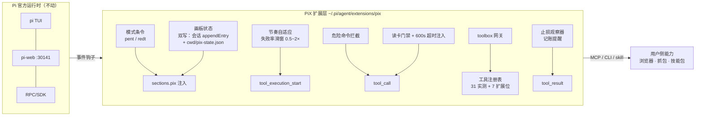
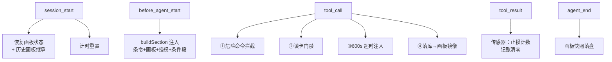

<div align="center">

# 🛡️ PiX — 假设驱动、自带渗透工具箱的 Pi Agent 发行版

**把渗透工程师的推理方式固化成系统机制：假设驱动 · 失败反刍 · 能力位置变换，再配一个按需发现的本地工具箱。**

基于 [@earendil-works/pi-coding-agent](https://www.npmjs.com/package/@earendil-works/pi-coding-agent) 扩展机制二次开发 · 不改上游一行代码 · 一切皆插件

     

</div>

---

## ✨ 特性一览

- 🧠 **机制化渗透纪律**：事实画板、失败强制回读、元认知反思、节奏自适应——不是提示词恳求，是事件钩子硬机制
- 🧰 **自带工具箱**：31 个实测渗透工具 + 7 张扩展位卡，`toolbox` 网关按需发现（list / howto / search）
- 🛡️ **双重护栏**：读卡门禁（未读卡禁调工具）+ 本机危险命令拦截 + 600s 超时注入
- 📊 **画板知识继承**：状态跨会话持久化，下次开工自动继承上次画板（不重复侦察）
- 🧾 **报告管线**：`/report` 一键生成（漏洞清单 + 攻击链 Mermaid 配图 + 证据闸门）
- 🔬 **客观传感器**：连续拦截/报错自动触发止损提醒，不依赖 agent 自报

---

## 📦 获取方式（重要，先看这里）

| 方式 | 内容 | 能否直接使用 |
|---|---|---|
| **A. 完整目录分发（推荐）** | 整个 PiX 目录，**含 `tools/`（约 2GB）**：31 个实测工具 + 全量字典树 + nuclei-templates 已内置 | ✅ 满足前置环境后**开箱即用** |
| **B. git clone（代码版）** | 仅代码（35 个文件），**不含 `tools/` 工具面** | ⚠️ 扩展可加载，但工具卡全部显示"不可用"——需自行放置 `tools/` 或设 `PIX_TOOLS_ROOT` 指向工具根 |

> **结论**：**直接用方式 A**（完整目录）。若走 git clone，工具面需另行获取——PiX 不提供在线工具下载脚本（工具内置化设计）。

---

## 🧰 前置要求（Windows）

| 环境 | 用途 | 安装命令 |
|---|---|---|
| **Node.js ≥ 22** | pi / pi-web 运行时 | `winget install OpenJS.NodeJS.LTS` |
| **Python 3.10+** | python 系工具（OneForAll/sqlmap 等）+ pi-web 补丁脚本 | `winget install Python.Python.3.10` |
| **Git** | 拉取/更新仓库 | `winget install Git.Git` |
| **Npcap** | nmap / naabu(SYN) / masscan 抓包驱动 | [npcap.com 官网下载](https://npcap.com/#download)（勾选 WinPcap 兼容模式） |

> Linux/macOS：工具卡路径为 Windows 口径，需自行改 `extension/toolbox-data.ts` 注册表路径。

---

## 🚀 快速开始

```bash
# 1. 安装 pi 运行时（全局）
npm install -g @earendil-works/pi-coding-agent @agegr/pi-web

# 2. 进入 PiX 目录，部署扩展（自动写 pix-config.json 定位工具根）
cd PiX
node scripts/install.mjs

# 3. 启动（二选一）
scripts\pix-web.cmd        # Web UI（推荐）：启动后访问 http://127.0.0.1:30141
pi                         # 终端 TUI
```

启动后应看到通知 **「PiX 已加载 · 模式=pent · 节奏=自适应 2s」**；全新会话再收到「上手三步」引导。

## 🔑 配置模型（必须）

pi 默认无可用模型，首次使用需在 **pi-web 设置 → 模型** 或 `~/.pi/agent/models.json` 配置：

```json
{
  "providers": {
    "my-provider": {
      "baseUrl": "https://你的模型网关/v1",
      "models": [{ "id": "你的模型", "name": "你的模型", "supportsDeveloperRole": false }]
    }
  }
}
```

- OpenAI 兼容端点均可（`openai-completions` 协议）；`supportsDeveloperRole: false` 解决 `developer is not one of [...]` 报错
- 配好后在会话里选该模型即可

## 🌐 可选：外部能力接入

- **浏览器控制**：自配 `chrome-devtools-mcp`（`npx chrome-devtools-mcp@latest`）
- **抓包/重放**：自配 Burp Suite MCP bridge
- **技能包**：PiX 自带两个兜底技能（`pix-workflow` / `pix-report`）；如需完整渗透/红队技能包，把技能目录加入 pi 技能路径即可，PiX 条令第 0 条自动让位

---

## 🏗️ 架构



### 运行时工作流



---

## ⚙️ 两模式

| | `/mode pent`（默认） | `/mode redt` |
|---|---|---|
| 定位 | SRC / 授权渗透 | 红队演练 |
| 授权事实源 | `/auth` 登记范围 | `/task` 任务书 |
| 节奏基准 | 2s（自适应 1~4s） | 1s（自适应 0.5~2s） |
| 核心条款 | 拖库口径（最小样本）· RCE 无害回显 · 禁 nuclei 全扫 | 任务书围栏 · 数据不出域 · 武器化按技能包 |

## 🧠 核心机制

1. **三段状态机 → 画板**：`[C]能力 / [F]失败 / [H]假设 / [N]发现`，`leads_to` 边即攻击链
2. **失败强制回读**：同方向失败 ≥6 次 → 自动注入回读指令（沿 `similar_to/substitutes` 边找可迁移能力）
3. **元认知反思**：失败率 ≥60% → 注入反思段（两模式差异化）
4. **节奏自适应**：`clamp(1+(失败率-0.5)×2, 0.5, 2)`——连败加倍克制、连胜自动提速
5. **本机危险命令分级拦截**：删盘/关机/格盘类——有 UI 弹确认，无 UI 直接拦截
6. **画板跨会话继承**：`cwd/pix-state.json` 原子双写，新会话注入【历史画板】摘要防重复侦察

## 🧰 工具箱

工具面不占 system prompt——单个 `toolbox` 工具按需发现：

```
toolbox({action:"list"})                        # 分类分组全量（含可用性探测）
toolbox({action:"search", task:"目录爆破"})      # 任务关键词 → top3 候选
toolbox({action:"howto", tool:"sqlmap"})        # 完整工具卡：唯一姿势/硬约束/参数/陷阱
```

**内置注册表 = 38 张工具卡**（31 实测 + 7 扩展位：隧道/代理 5、提权枚举 3，转子女神已剔除）：

| 分类 | 工具 |
|---|---|
| 信息收集 | subfinder / OneForAll / crt.sh / httpx / EHole / nmap / naabu / masscan / dirsearch / ffuf / URLFinder / LinkFinder / katana / waybackurls |
| 漏洞利用 | sqlmap / nuclei(+templates) / jwt_tool / JWTCrack |
| 内网横向 | fscan / netexec / impacket（+ chisel / frp / proxychains / ssh-tunnel / socat 扩展位） |
| 逆向/容器 | capa / radare2 / yara-x / trivy / strings-bin |
| 云只读 | aws-cli / az-cli / gcloud-ro / kubectl-ro |

**纪律**：凡调用注册表工具，先 `toolbox howto` 读卡再拼命令——未读卡会被门禁拦截（这是故意的）。`/toolbox export` 可导出全量工具卡手册（单文件 MD）。

## 📖 命令与工具参考

| 命令 | 用途 |
|---|---|
| `/mode pent \| redt` · `/mode adaptive on\|off` | 切换模式 / 节奏自适应开关 |
| `/auth <目标...> --source <来源>` | 登记授权范围（注入围栏） |
| `/task <任务书.md>` | 登记红队任务书 |
| `/pix` · `/pix export` | 状态总览 / 画板双 Mermaid 落盘 |
| `/report` | 渗透报告（漏洞清单 + 攻击链配图 + 证据闸门） |
| `/toolbox export` | 全量工具卡手册导出 |

| 工具 | 用途 |
|---|---|
| `record_fact` / `record_capability` / `record_failure` | 画板记节点 + 连边 / 能力 / 失败计数（≥6 触发回读） |
| `update_node` | 节点状态流转（confirmed 联动节奏窗口） |
| `get_state` / `get_task` | 读画板全量 / 任务书全文 |
| `export_map` | Mermaid 关系图（会话内返回） |
| `toolbox` | 工具注册表网关 |

## 🧪 验收

离线验收（真实 pi RPC + stub 模型回放，不打目标）：

```bash
cd acceptance && npm install && node run-acceptance.mjs
# 或一键（检查→部署→验收）
node scripts/ci-acceptance.mjs
```

31 项断言：模式注入（pent/redt/授权/任务书）、失败 6 次回读、元认知反思、节奏墙钟实测（连败 2s/连胜 0.5s/基准 2s）、护栏拦截、读卡门禁拦/放、会话重载读回、toolbox 三入口、update_node 联动、画板/报告落盘、历史画板继承。全程绿色即通过。

## 🔧 故障排查

| 症状 | 处置 |
|---|---|
| 启动无「PiX 已加载」通知 | `node scripts/install.mjs --status` 查文件一致性 |
| 工具卡显示「不可用」 | howto 里的 reason 给出原因；工具根可用 `PIX_TOOLS_ROOT` 覆盖 |
| 模型报 `developer is not one of [...]` | models.json 对应模型加 `"compat": {"supportsDeveloperRole": false}` |
| pi-web 推理菜单档位混乱 | 重跑 `node scripts/install.mjs --restart-piweb` |
| 验收某步 FAIL | 看输出 evidence；先确认扩展最新（install.mjs --status） |

---

## ⚖️ 合规声明

PiX 仅面向**已授权的安全测试**（自建靶场、书面授权 SRC、红队任务书范围）。pent 模式内置授权首条红线；redt 模式以任务书围栏。禁止用于未授权测试、DoS、数据牟利。使用者自行承担合规责任。

---

<div align="center">

**MIT License · 机制设计源自实战渗透方法论 · 工具与技能一切皆插件**

</div>
