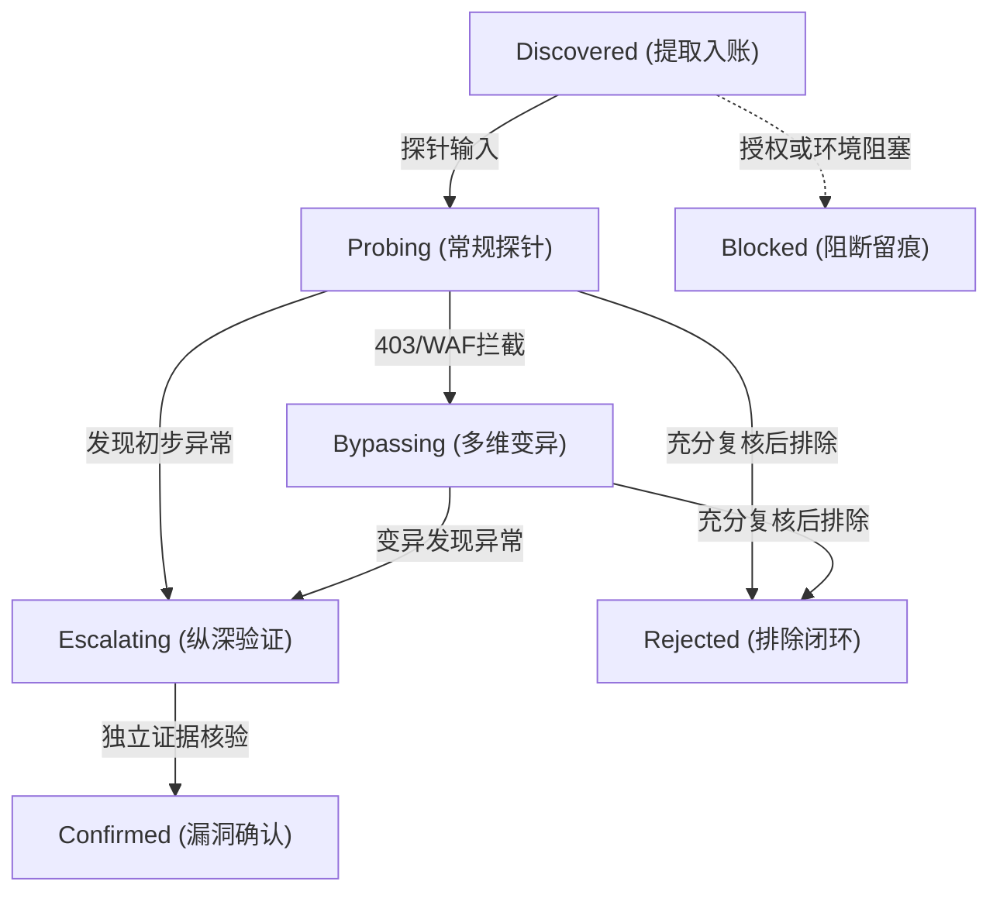

# PiX 攻防接口状态机与闭环机制白皮书 (Mechanism Architecture Whitepaper)

本文说明目标流程与 v2.9.1 的实际实现边界。推荐流程和设计约束不等同于代码已强制执行；尚未实现的 Worker 架构及相关机制见各 ADR 的版本状态。文中的域名、IP、报文、统计与场景均为虚构示例，不代表真实秘密、已发现漏洞或实测结果。

## 一、设计动机

攻防 Agent 的长会话可能出现上下文遗漏、根据单次响应过早下结论，以及测试过程难以观察等问题。PiX 采用结构化事实记录、端点台账、报告模板和看板辅助核查，减少对模型口头承诺的依赖。这些机制有助于复核过程，但不能单凭状态标签证明漏洞成立、全部接口已测或目标安全。

## 二、七态端点台账与推荐流程

下图描述推荐测试流程，**不是不可逆的强制迁移图**。v2.9.1 的 `updateEndpointStatus` 直接写入所选状态，没有校验前后状态的迁移矩阵；已闭环端点也可以重新进入测试状态。



### 状态含义与当前实现边界

| 状态 | 推荐含义 | v2.9.1 实现与限制 |
|---|---|---|
| `discovered` | 已提取待测 | 新端点通常以此状态入账；提取存在过滤与数量上限，不代表已收齐资产 |
| `probing` | 常规探针测试中 | 状态更新会增加 `testedTimes` 并追加历史；计数不自动证明真实发包或有效测试 |
| `bypassing` | 遇阻后进行变异验证 | 更新时可递增变异级别；没有校验变异内容或覆盖维度 |
| `escalating` | 初步异常后的纵深验证 | 状态可直接写入，不要求先通过异常证据门禁 |
| `confirmed` | 经证据核验确认漏洞 | `evidenceRequest`、`evidenceResponse` 为可选字段；当前不物理强制证据绑定或先通过 verifier |
| `rejected` | 充分复核后排除当前假设 | `update_endpoint` 工具检查更新前 `testedTimes >= 3`；不核验 L4 维度覆盖，底层状态写入函数也不执行该门禁 |
| `blocked` | 授权、网络或环境阻塞 | 可附证据，但当前没有强制阻塞证据字段；该状态不代表目标安全 |

`confirmed`、`rejected`、`blocked` 在统计中被计为闭环；这只是台账状态统计。结论质量仍需对照原始请求、响应差分、授权范围和实际测试记录复核。

## 三、五项机制及其边界

### 1. 结案检查与宿主集成尝试 (`agent_before_settle`)

`gate.ts` 的 `verifyAntiSlothGate` 检查台账中是否还有非闭环端点，并可返回下一优先端点。推荐的结案条件为：

$$\text{Can\_Wrapup} = \text{True} \iff \forall ep \in \text{Endpoints}, \text{Status}(ep) \in \{\text{Confirmed}, \text{Rejected}, \text{Blocked}\}$$

`index.ts` 通过对 `pi.on` 进行类型转换，尝试注册 `agent_before_settle`，在发现未闭环端点时返回 `{ continue: true, entries: [...] }`。**宿主事件触发与续跑语义尚未完成联调验证**，不能宣称运行时已强制阻止提前结案。该检查基于已有台账，也不能发现尚未入账的端点。

### 2. 大输出归档与按行读取 (`artifacts.ts`)

- 触发条件是 JavaScript 字符串 **`rawText.length > 2048`**，按 UTF-16 代码单元计数，不是 UTF-8 字节数。
- 对原文计算 SHA-256，取十六进制摘要的**前 10 位**命名 `.pix/artifacts/art_<hash>.log`，文件包含元信息头与原文；这不是完整哈希或不可篡改证据库。
- 上下文替换文本包含归档路径、头部前三行截取、尾部两行截取及读取提示，当前拼装为四行，**不是严格三行语义摘要**。
- `get_artifact` 可按行切片读取。当前写入异常被捕获而未向调用者报告，归档提示不等于已核实持久化成功；需要证据时应确认文件实际存在且可读。

### 3. 工具输出提取器 (`sniffer.ts`)

工具结果处理链可从工具输出文本中通过正则提取主机、端口、凭据及 Web/API 端点，包含对 Dirsearch、Ffuf、Katana、LinkFinder、Nuclei、NetExec 等输出格式的处理。正则匹配不能保证理解所有版本和格式，也不能保证提取全集。

`recordEndpoint` 按大写后的 HTTP method 与 `url.trim()` 后的完整 URL 精确去重，不做路径参数泛化。但 sniffer 会过滤静态资源、补全相对 URL，且单次最多保留 40 个不同端点；因此不能把该链路描述为全量原始资产保全。提取出的凭据和证据仍需脱敏，目标双层卫生闸门尚未实现。

### 4. 输入响应的机械差分评估器 (`verifier.ts`)

`verify_finding` 接收调用方提供的真假探针响应数据，再调用 `evaluateDifferential`；**它不会自行发送请求或独立复测**。当前判定顺序与阈值如下：

| 分支 | 当前条件 | 可证明的范围 |
|---|---|---|
| `sqli_time` | 真探针耗时 `>= 4000ms`，且与基线差 `>= 3500ms`；没有假响应时基线取 `500ms` | 输入耗时满足阈值；不能排除网络抖动、负载或不可靠输入 |
| SQL 报错指纹 | 真响应正文命中内置 SQL 错误正则；该检查先于后续状态码/长度比较 | 输入正文含错误特征；不要求对照组不同，不能独立证明可利用注入 |
| 状态码差分 | 存在假响应、两状态码不同且其中一个为 `200` | 输入状态码分化；不能独立证明越权或业务影响 |
| 长度差分 | `abs(trueBody.length - falseBody.length) / max(1, falseBody.length) * 100 >= 20` | 输入字符串长度变化至少 20%；长度单位同为 UTF-16 代码单元，不是字节 |
| `rejected` | 在前述检查未命中后，两状态码相同且正文长度相同 | 仅证明状态码与长度相同；未比较正文相等，不能证明参数已过滤或不存在漏洞 |

其余情况返回 `inconclusive`。这些是启发式分流信号，可能产生假阳性或假阴性。应结合真实报文、业务语义、重复对照及最小影响证据独立核验；不能宣称“杜绝假阳性”，也不能把评估器返回的证据摘要当作完整原始 HTTP 请求包。

### 5. 分级变异建议生成器 (`mutator.ts`)

生成器提供编码、语法、请求头、协议与语义等方向的变异建议。生成建议不等于已发送探针、已覆盖相应维度或已绕过防护；实际效果和授权边界需要逐项验证。

## 四、动态矩阵看板 (默认端口 30142)

以下为虚构布局示意，数字、域名与报文均不代表实测：

```text
PiX Live Attack Surface Matrix Dashboard
进度：20/26 个端点处于统计闭环状态
统计：4 台主机 | 26 个提取端点 | 3 个 confirmed 标签
主机：auth.example.test、oa.example.test、api.example.test
端点：[POST] /api/v1/reset_pwd | [GET] /system/status
证据栏：展示已记录的请求与响应片段，需独立核验及脱敏
```

- **只读 HTTP**：`matrix-server.mjs` 提供页面、`/events` SSE 与 `/api/matrix`，允许 GET/HEAD，拒绝其他方法；默认绑定 `127.0.0.1`。只读仍需限制本地绑定或部署访问控制，以及输出脱敏，不能据此免除鉴权需求或保证绝对安全。
- **文件总线**：`live-matrix.ts` 将更新在约 500ms 的窗口内合并，写临时文件后 rename 到 `cwd/pix-live-matrix.json`；rename 失败时会直接覆盖目标文件，**该回退路径不具备原子替换保证**。
- **推流时序**：服务端文件监听另有 150ms 防抖，再向浏览器推送快照。文件系统事件、I/O、事件循环与客户端连接都会影响延迟，不保证零延迟或固定毫秒内送达。
